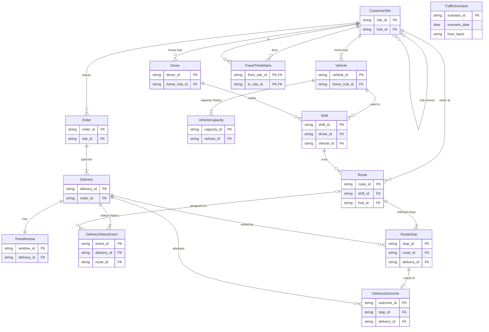

# ER diagram

Keys and foreign keys only. Full field lists are in [data_dictionary.md](data_dictionary.md).

## Bridge tables

- **Shift** links Driver and Vehicle (N:M).
- **RouteStop** links Route and Delivery (N:M). A delivery has no stop while unserved and gets a new stop on a later route when retried.
- **TravelTimeMatrix** links CustomerSite to CustomerSite (N:M), one row per ordered pair.

## Traffic scenario

TrafficScenario has no foreign key and no line in the diagram. Actual travel minutes are `base_travel_minutes x traffic_factor`, computed by matching a leg's departure date and hour band to the scenario row. The value is never stored.

## Deviation from the original 12 entities

DeliveryStatusEvent and TrafficScenario were added. DeliveryStatusEvent keeps delivery states as append-only rows. TrafficScenario lets the travel matrix stay static (about 250,000 rows at full scale instead of about 37 million).
